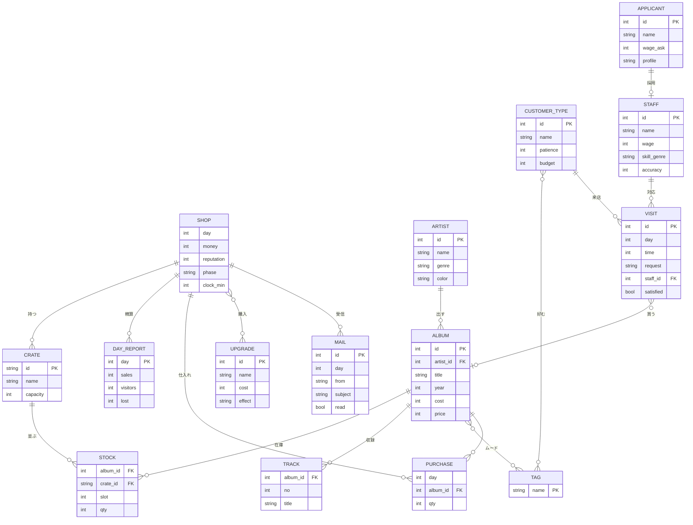

# 設計メモ

## コンセプト
架空のレコードショップ「路地灯」の経営シミュレーター（PCブラウザ向け）。
最初は自分で接客し、稼いで品揃えを増やし、擬似PCで店員を雇って店を回せるようにしていく。放置ゲームではない。

- 1日 = 営業 10:00〜19:00 を実時間30分に圧縮（ゲーム内1分 ≒ 3.3秒）
- 開店前は時間停止。準備が済んだら開店。閉店は19:00のみ（途中で閉められない）
- 閉店後に精算 → 翌日の開店前へ
- タブを離れる・アプリを閉じると一時停止
- 擬似PCは営業中も触れる。PCを開いている間は店頭が無人になる
- 仕入れは当日即時入荷

## Web UI要素の割り当て
| 要素 | 使いどころ |
|---|---|
| ハンバーガーメニュー | 擬似PC内サイトのナビ（v0.2） |
| パンくずリスト | 店内 ＞ 棚 ＞ アルバム／仕入れサイトの階層 |
| カルーセル | 仕入れサイトの新譜特集（v0.2） |
| モーダル | アルバム詳細、面接、精算 |
| アコーディオン | 収録曲、アップグレード一覧 |
| ラジオボタン | 求人条件（v0.3） |
| プルダウン | ジャンル・並び順の絞り込み、店員の担当 |
| ページネーション | 棚の中、応募者一覧 |
| キネティック・タイポ | 客のセリフ、売れた瞬間のスタンプ |
| UI/UXアニメーション | ボタン、プルダウン、モーダルの動き |
| インフォグラフィック | 精算の時間帯別来店、売上管理ソフト（v0.4） |

## ER図

ALBUM（商品カタログ）と STOCK（棚に並んだ実物）を分けている。仕入れはカタログから買い、STOCKに入る。

## ロードマップ
- [x] **v0.1 店頭と時計**：開店前→営業→精算の流れ、手売り（パンくず・プルダウン・ページネーション・モーダル・アコーディオン）、客のセリフのキネティック・タイポ、保存
- [ ] **v0.2 擬似PC**：デスクトップとハンバーガーメニュー、仕入れサイト（カルーセル・パンくず・即時入荷）、PC中は店頭が無人
- [ ] **v0.3 雇用**：求人サイト（ページネーション・ラジオ・プルダウン・面接モーダル）、店員の自動接客と時給
- [ ] **v0.4 経営の見える化**：売上管理ソフト（インフォグラフィック）、メール
- [ ] **v0.5 成長要素**：アップグレード、棚の追加、客タイプの解放、常連化
- [ ] **以降**：バランス調整、フロア追加・2号店など
